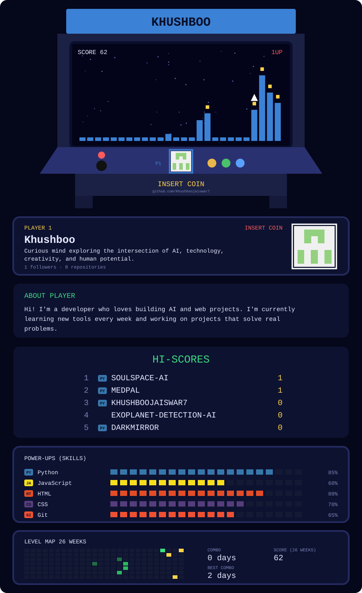

*The level is my last 26 weeks of contributions; coins mark my busiest weeks.*

## 👋 About Me
Hi, I'm **Khushboo**. I'm a [student / developer / your role] who loves building [AI, web apps, healthcare tech, etc.].
I'm currently learning **[what you're learning]** and working on **[current project]**.

- 🎓 Studying: [your course / college]
- 🌱 Learning: [topics]
- 📫 Reach me: [your email or LinkedIn]

## 🛠️ Skill Set

  

| Area | Skills |
|------|--------|
| Languages | Python, JavaScript, HTML, CSS |
| AI / Data | [Pandas, NumPy, Scikit-learn, TensorFlow] |
| Tools | Git, GitHub, VS Code |

## 🚀 Projects

### 💊 MedPal
[One line: what it does and who it's for.]
**Tech:** Python · [other tools] · [🔗 View repo](https://github.com/Khushboojaiswar7/MedPal)

### 🪐 Exoplanet Detection AI
[One line: what it does.]
**Tech:** Python · [ML libraries] · [🔗 View repo](https://github.com/Khushboojaiswar7/Exoplanet-Detection-AI)

### 🪞 DarkMirror
[One line: what it does.]
**Tech:** [tools] · [🔗 View repo](https://github.com/Khushboojaiswar7/DarkMirror)

### 🧑‍💻 CodeCraftHub
[One line: what it does.]
**Tech:** [tools] · [🔗 View repo](https://github.com/Khushboojaiswar7/CodeCraftHub)

## 📊 GitHub Stats

  
  

## 📬 Contact
[GitHub](https://github.com/Khushboojaiswar7) · [LinkedIn](https://linkedin.com/in/yourname) · [Email](mailto:you@example.com)

